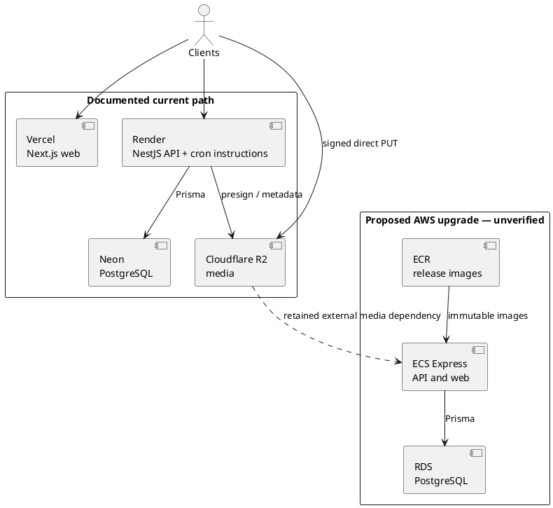

# Baydar / Bayader — Confidential AWS Well-Architected Sustainability Review

> **Classification: CONFIDENTIAL** — Repository architecture and remediation detail. No credentials, secret values, cloud resources, provider accounts, or runtime services were queried or modified.

**Method:** Offline, pillar-scoped review of the supplied frozen corpus and repository source. **Assessment date: 2026-11-12.** Statuses describe evidence in source, not verified production operation. “Implemented” can therefore mean an implemented application/design control; it does not prove deployment or outcomes.

## Coverage audit

- **Scope:** Sustainability only — **6/6 SUS questions and 29/29 SUS best practices**, each assessed once with its canonical title.
- **Corpus provenance:** AWS Well-Architected Framework TOC index, retrieved **2026-11-12T06:51:20.168Z** by `mcp_toc_index`; supplied frozen-manifest validation passed. No documentation was re-enumerated.
- **BP status distribution:** **2 Implemented · 19 PartiallyImplemented · 0 NotImplemented · 1 NotApplicable · 7 CannotDetermine.**
- **Evidence boundary:** Application code, deployment documentation, GitHub workflows, and Terraform were inspected. Vercel/Render/Neon/R2 runtime configuration, carbon/energy data, demand, utilization, data volumes, and organizational interviews were unavailable.
- **Two baselines:** `docs/deployment.md:3-17` documents the **current Vercel/Render/Neon/R2 path**. `infrastructure/aws/README.md:1-3` calls AWS an **upgrade path**; its Terraform and workflow are treated as **proposed and unverified**, never as deployed actuals.

## Executive summary

Baydar has useful sustainability foundations: managed services, direct client-to-R2 uploads that bypass API media proxying, bounded upload sizes, cursor pagination and query consolidation, client caching/placeholders, ECR expiry, account retention, and proposed RDS storage autoscaling. These are design strengths, not measured reductions in energy or carbon.

The largest confirmed gap is incomplete media lifecycle management: direct uploads can create objects, but the reviewed application contains no R2 object-deletion path and orphaned-upload cleanup is explicitly deferred. Demand-aligned compute is also unproven: proposed CPU/memory sizes are defaults, current provider sizing is absent, and no autoscaling policy or utilization baseline was found. Current Render schedules are documentation-only in this repository, while the proposed AWS path contains no retention/Karama scheduler.

**Score: 14/30 (2.3/5).** BP-level risks: **0 Critical · 3 High · 4 Medium · 12 Low**; seven CannotDetermine entries are unclassified rather than assumed safe or unsafe. No quantitative environmental impact is asserted.

## Architecture overview

The current topology intentionally uses managed services. A future migration must account for the retained external R2 dependency and avoid counting current and proposed compute as simultaneously deployed.

## Scorecard and question assessment

Scores use: **5** = all applicable practices demonstrated with outcome evidence; **4** = strong implementation with minor gaps; **3** = substantive implementation but material gaps; **2** = significant gaps or unknowns; **1** = little supporting evidence. Runtime carbon/utilization evidence caps confidence.

| ID | Canonical question | Score | Status | Assessment |
|---|---|---:|---|---|
| SUS01 | SUS 1 How do you select Regions for your workload? | 2 | PartiallyImplemented | Proposed AWS is fixed to `eu-north-1`, but current provider Regions and a joint business/sustainability comparison are not documented. |
| SUS02 | SUS 2 How do you align cloud resources to your demand? | 2 | PartiallyImplemented | Throttling and proposed database storage elasticity exist; compute demand, scaling, SLAs, placement, and team-resource actuals remain unknown. |
| SUS03 | SUS 3 How do you take advantage of software and architecture patterns to support your sustainability goals? | 3 | PartiallyImplemented | Direct uploads, query consolidation, pagination, caching, and job endpoints are present; scheduling and measured hot-path/device optimization are incomplete. |
| SUS04 | SUS 4 How do you take advantage of data management policies and patterns to support your sustainability goals? | 2 | PartiallyImplemented | Appropriate object/relational technologies and partial retention exist; data classification, complete media cleanup, network-flow evidence, and backup scope are gaps. |
| SUS05 | SUS 5 How do you select and use cloud hardware and services in your architecture to support your sustainability goals? | 3 | PartiallyImplemented | Managed services are consistent across both paths and proposed RDS uses Graviton; sizing is not utilization-led and accelerator use is absent. |
| SUS06 | SUS 6 How do your organizational processes support your sustainability goals? | 2 | PartiallyImplemented | CI/CD and selective expensive tests support iteration; sustainability ownership/goals, update cadence, build-efficiency outcomes, and device-farm decisions are unknown. |
|  | **Sum** | **14 / 30** |  | **Average 2.3 / 5; design evidence, not measured environmental performance.** |

## Full BP Ledger — Sustainability

Risk uses **Impact × Likelihood** with the review matrix. Impact concerns sustainability/resource-management consequences, not generic cost, security, or reliability.

| BP ID and canonical title | Status | Risk: Impact × Likelihood | Evidence and recommendation |
|---|---|---|---|
| SUS01-BP01 — Choose Region based on both business requirements and sustainability goals | PartiallyImplemented | **Low — Minor × Medium** | Proposed AWS defaults and workflow pin `eu-north-1` (`infrastructure/aws/variables.tf:9-12`; `.github/workflows/deploy-aws.yml:36-40`), but no Region comparison or current Vercel/Render/Neon Region evidence exists. **[Observed in code/IaC; Not observed within declared scope]** Record a decision covering data residency, user latency, service needs, and published provider energy/carbon data; do not presume the configured Region is optimal. |
| SUS02-BP01 — Scale workload infrastructure dynamically | PartiallyImplemented | **Medium — Moderate × Medium** | Proposed RDS storage autoscaling is bounded at 20–100 GB production and fixed at 20 GB staging (`infrastructure/aws/database.tf:19-25`), but no compute autoscaling resource/signal was found; ECS CPU/memory defaults are 256/512 (`infrastructure/aws/variables.tf:39-54`). Current Render scaling is unknown. **[Observed in code/IaC; Cannot determine]** Baseline demand and test scaling against SLOs before changing capacity. |
| SUS02-BP02 — Align SLAs with sustainability goals | CannotDetermine | — | No approved SLA/SLO document relates availability, recovery, retention, or performance targets to resource use. **[Not observed within declared scope]** Product and platform owners must supply actual targets and approve any trade-off; do not lower resilience speculatively. |
| SUS02-BP03 — Stop the creation and maintenance of unused assets | PartiallyImplemented | **High — Moderate × High** | ECR retains the latest 30 images (`infrastructure/aws/compute.tf:15-30`) and expired soft-deleted users are purged (`apps/api/src/modules/account/account-retention.service.ts:19-49`). However, orphaned R2 cleanup is deferred (`docs/audit/SPRINT-20-DECISIONS.md:23-29`) and scoped source searches found no R2 deletion call. **[Observed in code/IaC]** Inventory unused assets and automate safe orphaned-media expiry plus whole-environment review. |
| SUS02-BP04 — Optimize geographic placement of workloads based on their networking requirements | CannotDetermine | — | Direct R2 upload reduces an API hop (`apps/web/src/lib/uploads.ts:10-12,33-43`), but provider locations, user latency, egress routes, and cache behavior are unknown. **[Observed in code/IaC; Cannot determine]** Measure client-to-web/API/R2 flows and placement before selecting or moving Regions. |
| SUS02-BP05 — Optimize team member resources for activities performed | CannotDetermine | — | Local/release commands are documented, but developer workstation, build-agent, test-device, and activity-level resource policies are not. **[Not observed within declared scope]** Interview engineering owners and map resource use by development, build, and test activity. |
| SUS02-BP06 — Implement buffering or throttling to flatten the demand curve | PartiallyImplemented | **Low — Minor × Medium** | Global throttling and media-specific limits exist (`apps/api/src/app.module.ts:33-35,52,77-79`; `apps/api/src/modules/media/media.controller.ts:26-34,41-47`), and direct uploads avoid API media transfer. No workload-wide queue/backpressure design or demand curve was found. **[Observed in code/IaC]** Use load evidence to add bounded buffering only where bursts justify it. |
| SUS03-BP01 — Optimize software and architecture for asynchronous and scheduled jobs | PartiallyImplemented | **Medium — Moderate × Medium** | Retention and monthly Karama endpoints exist (`apps/api/src/modules/admin/admin-internal.controller.ts:41-53`), and Render Cron use is documented (`docs/deployment.md:74-84`). No cron expression or AWS scheduler is defined; media scanning is inline/event-driven (`apps/api/src/modules/media/media.controller.ts:36-47`). **[Observed in code/IaC]** Codify target schedules and idempotent runs; retain event-driven scanning rather than polling buckets. |
| SUS03-BP02 — Remove or refactor workload components with low or no use | CannotDetermine | — | Repository documentation records cleanup and hot-path refactoring, but component usage/runtime telemetry needed to identify low-use workloads is absent. **[Not observed within declared scope]** Review route/job/component utilization with owners before removal or refactoring. |
| SUS03-BP03 — Optimize areas of code that consume the most time or resources | PartiallyImplemented | **Low — Minor × Medium** | Feed consolidation replaces four round trips with one indexed query (`apps/api/src/modules/feed/feed.service.ts:22-26`), and last-seen writes are throttled (`apps/api/src/modules/auth/last-seen.tracker.ts:5-13,22-40`). Lighthouse budgets exist, but no saved baseline or CPU/memory hot-path profile was found. **[Observed in code/IaC]** Profile highest-load routes and add resource regression evidence to the existing load tests. |
| SUS03-BP04 — Optimize impact on devices and equipment | PartiallyImplemented | **Low — Minor × Medium** | Mobile images use memory/disk cache and blurhash (`apps/mobile/src/components/rows/PostRow.tsx:75-87`); web query caching suppresses focus refetches (`apps/web/src/lib/query-provider.tsx:12-24`). Upload bounds are explicit, but no adaptive media variants or measured low-end-device transfer/battery profile exists. **[Observed in code/IaC; Cannot determine]** Measure bytes and responsiveness on representative devices and add server-side variants only where measurements justify them. |
| SUS03-BP05 — Use software patterns and architectures that best support data access and storage patterns | PartiallyImplemented | **Low — Minor × Medium** | Media bytes go directly to object storage, while feed/jobs use cursor pagination (`apps/web/src/lib/uploads.ts:10-12`; `apps/api/src/modules/feed/feed.service.ts:47-62`; `apps/api/src/modules/jobs/jobs.service.ts:80-94`). **[Observed in code/IaC]** Preserve these patterns and complete an access-pattern matrix for remaining datasets; validate query plans at realistic volume. |
| SUS04-BP01 — Implement a data classification policy | CannotDetermine | — | Source identifies account and media data, but no approved classification linking data classes to access, storage, retention, deletion, and backup tiers was found. **[Not observed within declared scope]** Data owners must supply the policy and classify 100% of identified data classes. |
| SUS04-BP02 — Use technologies that support data access and storage patterns | PartiallyImplemented | **Low — Minor × Medium** | PostgreSQL/Prisma supports relational queries and R2 supports object media (`README.md:21-25`); proposed RDS and ECS are managed (`infrastructure/aws/README.md:1-3`). Actual volumes and access distributions were not available to validate fit. **[Observed in code/IaC; Cannot determine]** Validate technology choices against measured cardinality, query, retention, and transfer patterns. |
| SUS04-BP03 — Use policies to manage the lifecycle of your datasets | PartiallyImplemented | **High — Moderate × High** | Account grace is 30 days, proposed RDS backups are 1/14 days, migration logs are 30/90 days, and ECR keeps 30 images (`apps/api/src/modules/account/account-retention.service.ts:1`; `infrastructure/aws/database.tf:31-35`; `infrastructure/aws/migration.tf:1-4`; `infrastructure/aws/compute.tf:15-30`). R2 lifecycle coverage is missing. **[Observed in code/IaC]** Define per-class retention and implement R2 lifecycle rules without deleting referenced or legally required objects. |
| SUS04-BP04 — Use elasticity and automation to expand block storage or file system | PartiallyImplemented | **Low — Minor × Medium** | Proposed RDS uses 20 GB initial storage with environment-specific maxima (`infrastructure/aws/database.tf:19-25`). Current Neon storage elasticity and deployed RDS behavior were not verified. **[Observed in code/IaC; Cannot determine]** Confirm provider behavior, alert on headroom, and test expansion without overprovisioning by default. |
| SUS04-BP05 — Remove unneeded or redundant data | PartiallyImplemented | **High — Moderate × High** | Account retention deletes expired user rows (`apps/api/src/modules/account/account-retention.service.ts:19-49`), but scoped searches found no `DeleteObject`/`DeleteObjects` use and orphaned R2 cleanup is deferred (`docs/audit/SPRINT-20-DECISIONS.md:29`). **[Observed in code/IaC]** Add reference-aware cleanup for abandoned uploads and deleted content/accounts, with dry-run reporting and protected-object tests. |
| SUS04-BP06 — Use shared file systems or storage to access common data | Implemented | — | R2 is the shared object store for web and mobile media; both clients use the same presign/direct-PUT pattern (`apps/web/src/lib/uploads.ts:33-48`; `apps/mobile/src/lib/uploads.ts:44-66`). **[Observed in code/IaC]** Keep common media in R2 and avoid per-service copies. |
| SUS04-BP07 — Minimize data movement across networks | PartiallyImplemented | **Medium — Moderate × Medium** | Web explicitly avoids sending media bytes through the API (`apps/web/src/lib/uploads.ts:10-12,39-43`), and mobile also PUTs directly (`apps/mobile/src/lib/uploads.ts:44-58`). Cross-provider routes, downloads, cache-hit ratios, and transfer volumes are unmeasured. **[Observed in code/IaC; Cannot determine]** Model GB/request by flow and measure caching before changing topology. |
| SUS04-BP08 — Back up data only when difficult to recreate | PartiallyImplemented | **Low — Minor × Medium** | Proposed RDS backups are environment-scoped (`infrastructure/aws/database.tf:31-35`), but no data inventory distinguishes reproducible from hard-to-recreate R2/configuration data; current Neon backup policy is unknown. **[Observed in code/IaC; Cannot determine]** Approve backup necessity and retention per data class; do not remove required recovery coverage for sustainability alone. |
| SUS05-BP01 — Use the minimum amount of hardware to meet your needs | PartiallyImplemented | **Medium — Moderate × Medium** | Proposed API/web sizes are 256 CPU/512 MB and RDS differs by environment (`infrastructure/aws/variables.tf:39-54`; `infrastructure/aws/database.tf:19-25`), but these are not backed by utilization or benchmark results; current Render/Neon sizing is unknown. **[Observed in code/IaC; Cannot determine]** Run the existing smoke/baseline/high/spike profiles and right-size only after a 30-day baseline with SLO guardrails. |
| SUS05-BP02 — Use instance types with the least impact | PartiallyImplemented | **Low — Minor × Medium** | Proposed RDS selects Graviton-based `db.t4g.micro`/`medium` by environment (`infrastructure/aws/database.tf:19-24`), while the migration task explicitly selects X86_64 (`infrastructure/aws/migration.tf:19-29`). No comparative efficiency test supports these choices. **[Observed in code/IaC]** Benchmark supported ARM64 images/tasks where compatible and record performance-per-resource results. |
| SUS05-BP03 — Use managed services | Implemented | — | The documented current path uses Vercel, Render, Neon, and R2 (`docs/deployment.md:3-15`); the proposed path uses ECS Express, RDS, and ECR rather than self-managed servers (`infrastructure/aws/README.md:1-3`). **[Observed in code/IaC]** Retain managed services where they meet measured requirements and avoid running duplicate stacks. |
| SUS05-BP04 — Optimize your use of hardware-based compute accelerators | NotApplicable | — | Reviewed application manifests and infrastructure define a web/API/mobile/PostgreSQL workload with no GPU or other hardware accelerator. **[Observed in code/IaC]** Reassess only if an accelerator-dependent feature is introduced. |
| SUS06-BP01 — Communicate and cascade your sustainability goals | CannotDetermine | — | No sustainability goals, named owner, review cadence, or team-facing targets were found; organizational communication outside the repository cannot be ruled out. **[Not observed within declared scope]** Interview leadership and publish an owned, measurable goal linked to the workload baseline. |
| SUS06-BP02 — Adopt methods that can rapidly introduce sustainability improvements | PartiallyImplemented | **Low — Minor × Medium** | Automated CI/CD and infrastructure as code provide repeatable change paths (`.github/workflows/ci.yml:23-193`; `.github/workflows/deploy-aws.yml:28-119`), but no sustainability experiment or measured improvement loop is evidenced. **[Observed in code/IaC]** Add small baseline-driven experiments with rollback and recorded resource outcomes. |
| SUS06-BP03 — Keep your workload up-to-date | PartiallyImplemented | **Low — Minor × Medium** | Node/pnpm/TypeScript versions and a lockfile are maintained (`package.json:6-9,39-50`), and proposed RDS selects the default engine version through a data source (`infrastructure/aws/main.tf:15-18`). Dependency-review/update cadence and ownership were not found. **[Observed in code/IaC; Not observed within declared scope]** Establish a scheduled, tested update process and record adopted efficiency-relevant updates. |
| SUS06-BP04 — Increase utilization of build environments | PartiallyImplemented | **Low — Minor × Medium** | CI cancels superseded runs and caches pnpm; E2E/Lighthouse are PR-only and mobile E2E is opt-in (`.github/workflows/ci.yml:9-11,33-39,129-132,168-171`; `.github/workflows/mobile-e2e.yml:3-7`). Jobs repeatedly install dependencies and rebuild web, with no shared artifact. **[Observed in code/IaC]** Reuse tested artifacts/caches and measure runner-minutes per accepted change without removing release gates. |
| SUS06-BP05 — Use managed device farms for testing | CannotDetermine | — | Mobile smoke uses Maestro on a GitHub-hosted emulator (`.github/workflows/mobile-e2e.yml:17-21,50-57`); real-device evidence remains owed (`docs/deployment.md:207-210`). External device-farm use is not established either way. **[Observed in code/IaC; Cannot determine]** Decide from required device coverage and measured runner/device effort. |

## Risk-classified findings

| Priority | Sustainability finding | Impact × Likelihood → risk | Required response |
|---|---|---|---|
| P1 | Orphaned/deleted-content media lacks a complete lifecycle despite direct R2 uploads and account retention. | **Moderate × High → High** | Inventory object states; implement reference-safe expiry/deletion with dry-run evidence and protected-object tests. |
| P2 | Compute sizing and dynamic scaling are not grounded in demand or utilization. | **Moderate × Medium → Medium** | Gather a 30-day multi-provider baseline, load-test proposed sizes, then define scaling and right-sizing guardrails. |
| P2 | Current schedules are not codified in source and proposed AWS lacks retention/Karama schedules. | **Moderate × Medium → Medium** | Encode owned schedules, prevent duplicate runs, and verify completion; keep media scanning event-driven. |
| P2 | Region, placement, data-transfer, and environmental decisions lack actuals. | **Moderate × Medium → Medium** | Record Regions and flows, measure latency/transfer, and compare published sustainability data before migration. |
| P3 | Sustainability goals, data classification, and SLA trade-offs are not evidenced. | **Minor × Medium → Low** | Assign owners and publish goals, data classes, retention/backup rules, and SLO-linked review criteria. |
| P3 | Build/device optimization has useful controls but no resource-outcome measurement. | **Minor × Medium → Low** | Reuse CI artifacts and measure runner/device effort; evaluate device farms only against coverage needs. |

**Trade-offs:** Lifecycle cleanup must not delete referenced media or rollback images still required by `infrastructure/aws/README.md:75-77`. Backups and availability targets must be business-approved before reducing retention or capacity. Region changes can add transfer and operational overhead; managed-service consolidation should not create duplicate current/proposed environments. These are design safeguards, not cost or generic reliability findings.

## SMART remediation plan

| Eisenhower priority | Action, deadline, and verification | Owner |
|---|---|---|
| **Do First — important / lower effort** | **Media lifecycle:** Within **10 business days**, inventory R2 object states and approve TTLs; implement abandoned-upload expiry and reference-aware cleanup for deleted content/accounts. In staging, demonstrate **100% of orphan fixtures reclaimed after the approved TTL and 0 referenced/protected fixtures deleted**, with before/after object and byte counts. | Application + data owners |
| **Do First — important / lower effort** | **Schedules:** Within **10 business days**, document actual Render cron expressions and add equivalent proposed AWS schedules for account retention and monthly Karama decay, including idempotency/concurrency protection. Verify **7 consecutive staging runs** at the intended cadence with no overlap; retain post-upload media scanning as event-driven. | Platform owner |
| **Plan — important / higher effort** | **Demand and sizing baseline:** Within **20 business days**, collect **30 days** of Vercel/Render/Neon/R2 requests, instance counts, p50/p95 CPU/memory where available, DB/R2 storage, and transfer; run the existing load profiles against proposed AWS sizes. Publish one signed baseline and scaling decision, and do not resize unless SLOs remain within approved limits. | Platform + performance owners |
| **Plan — important / higher effort** | **Region and placement decision:** By the same **20-business-day** review, document current provider Regions and compare the proposed `eu-north-1` path with permitted alternatives using measured user latency, residency/service constraints, network flows, and cited provider sustainability data. Approval requires an explicit decision record; no Region is declared greener without evidence. | Architecture review group |
| **Delegate — less urgent / lower effort** | **Goals and data governance:** Within **15 business days**, assign sustainability/data owners, approve SLA and retention trade-offs, and map **100% of identified data classes** to access, storage, lifecycle, deletion, and backup rules. Publish one measurable workload sustainability goal tied to the baseline. | Product + data governance |
| **Delegate — less urgent / lower effort** | **Build efficiency:** Within **15 business days**, remove redundant CI installs/builds through cached dependencies and reusable tested artifacts while preserving all gates. Compare runner-minutes per accepted change over the following **4 weeks** and record the result. | DevOps owner |
| **Defer — lower immediate importance** | At the next mobile QA review, within **30 days**, compare managed device farms with the existing emulator/manual matrix using required coverage and measured effort. Do no accelerator work unless an accelerator-dependent feature enters scope. | Mobile QA owner |

## Next steps

1. Resolve orphaned-media lifecycle first, then verify scheduled retention in the actual target platform.
2. Gather current-provider and proposed-AWS utilization/transfer evidence before sizing, scaling, or Region changes.
3. Re-run this pillar with runtime evidence and organizational interviews; convert CannotDetermine entries only when evidence is supplied, not by assumption.
